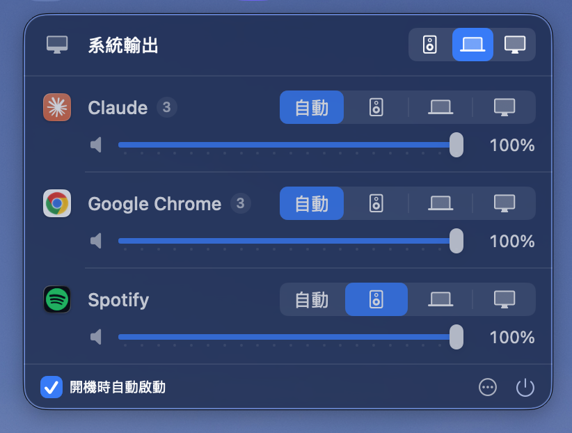

# SoundRouter

*[English](README.md) · 繁體中文*

macOS 上的 per-app 音訊分配器：把個別 App 的聲音導向不同的輸出裝置，各自調整音量與靜音。功能對應 SoundSource 的核心部分。

## 運作原理

macOS 14.4 之後 Core Audio 開放了 **process tap**，因此不需要安裝驅動或 kext 就能做到 per-app 路由。一條路由的組成：

1. `AudioHardwareCreateProcessTap` 針對目標行程建立 tap，`muteBehavior = .muted` 讓該行程原本的輸出路徑靜音；
2. 建立一個**私有 aggregate 裝置**，成員是「目標輸出裝置 + 上面那個 tap」；
3. 在 aggregate 上掛 `AudioDeviceIOProc`，把 tap 送進來的 input buffer 套上音量／平衡後寫進 output buffer。

擷取與播放在同一個 IOProc 裡完成，兩邊共用時脈；取樣率不同時由 tap 的 drift compensation 負責轉換。

> 本專案不提供預先建置的執行檔。請自行 clone 後建置——`.app` bundle 是取得音訊擷取授權的必要條件（原因見下方「權限」）。

## 需求

- **macOS 15 以上**（Core Audio 的 process tap 從 14.2 開始提供，但本專案的部署目標設在 15）
- Xcode 或 Command Line Tools（Swift 6）
- `build-app.sh` 產出 universal binary（arm64 + x86_64）。實測環境是 Apple Silicon + macOS 26，
  Intel 建得起來但沒有實機跑過

## 建置

```bash
./Packaging/build-app.sh
```

產出：

| 路徑 | 用途 |
| --- | --- |
| `build/SoundRouter.app` | 選單列 App（主要成品） |
| `build/AudioRouterProbe.app` | 帶 bundle 身分的 CLI，診斷用 |
| `.build/.../audiorouter` | 裸 CLI |

零外部相依，離線可建置。

執行測試用 `swift test`，涵蓋範圍見下方「測試」。

## 權限（**必讀**）

Process tap 需要系統音訊擷取授權。**沒有拿到授權時 tap 不會報錯，只會安靜地送回全零的靜音**——這是這套 API 最容易踩的坑，症狀是被路由的 App 直接沒聲音。除錯時請先確認授權。

授權的前提是執行檔要有 bundle 身分（Info.plist 裡的 `NSAudioCaptureUsageDescription` + 簽章）：

- **`SoundRouter.app`**：第一次建立路由時系統會跳出授權提示，允許即可。之後可在「系統設定 → 隱私權與安全性 → 螢幕與系統音訊錄製」調整。
- **裸 CLI**：從終端機執行時，TCC 認定的責任行程是終端機本身，所以要把終端機 App 加進上述清單。從其他程式（例如編輯器的內建終端）呼叫時通常拿不到授權。
- **`AudioRouterProbe.app`**：把同一支 CLI 包成 .app，用 `open` 啟動就有自己的 bundle 身分：

  ```bash
  open -n -a "$PWD/build/AudioRouterProbe.app" --args \
    --log /tmp/probe.log route Spotify --to 外接喇叭 --meter --debug --seconds 10
  ```

由於目前是 ad-hoc 簽章（機器上沒有 Developer ID），簽章雜湊會隨每次重建改變，**重建後可能需要重新授權一次**。若要避免，可在鑰匙圈建立一張自簽的程式碼簽章憑證，並以 `CODESIGN_IDENTITY="憑證名稱" ./Packaging/build-app.sh` 建置。

## 介面

點選單列圖示展開面板：



- **輸出裝置**：分段控制，一個裝置一段。選「自動」表示不介入，跟隨系統輸出。每段的圖示依**傳輸類型**決定，游標移上去顯示裝置名稱。
- **音量**：滑軌，分成 20 格、每格 5%，上限 100%（不做增益放大，避免破音）。
- **綠點**：該 App 正在出聲。
- **數字徽章**：這個 App 底下有幾個發聲行程（見下節）。
- **「未執行」徽章**：這個 App 有存下來的路由設定，但目前沒在跑。設定會保留，它回來時自動套用。
- **紅色三角形／ⓘ／轉圈**：路由建立失敗（游標移上去看訊息）、指定的裝置離線中而暫時走系統輸出、或引擎還在建立中。
- **在某一列按右鍵**可以「重設這個 App」；沒在跑的 App 還會多一項「移除這筆設定」。
- **右下刪節號**：顯示／隱藏系統程序。
- **最下方「開機時自動啟動」勾選框**：用 `SMAppService` 註冊登入項目。

最上面的系統輸出那一列跟下面的 App 列採用同樣的版面，因為它們本質上是同一種東西——一個播放目標，加一組輸出選擇。

它是全域預設裝置，只影響沒有單獨設定的 App。

## 播放源的分組

清單列出**所有播放源**，不限於當下正在出聲的——實務上多半是先設定好、之後才播放。

每一列是使用者眼中的一個 App，底下所有會發聲的行程都併在一起：

```
LINE
  ↳ LINE  pid 5756
  ↳ LINE.MediaService  pid 5762
  ↳ LINE.AudioService  pid 5767      ← 真正發聲的是這個
  …
```

這不只是介面上的整理，而是功能正確性的前提：瀏覽器、Slack、LINE 的音訊都由獨立的 helper 或 XPC 服務送出，只對主行程建 tap 會完全抓不到聲音。分組後一條路由涵蓋整組行程。

歸戶的判斷方式是**執行檔路徑**——helper 與 XPC 服務都住在所屬 App 的 bundle 裡（`/Applications/LINE.app/Contents/XPCServices/LINE.AudioService.xpc/…`），取路徑上最外層的 `.app` 即可。刻意不用父行程鏈當主要手段：XPC 服務是 launchd 啟動的，父行程是 launchd 而不是那個 App，而 XPC 服務往往正是發聲的那一個。父行程鏈只當備援。

系統守護程序（CoreSpeech、audiomxd、控制中心…）預設隱藏——機器上通常有二十幾個，全開會把真正的 App 淹掉。已經設定過的項目一律顯示，不受開關影響。

已知的例外：共用的系統 XPC 服務（例如 WebKit 的 GPU 行程，會顯示成「LINE Graphics and Media」）住在框架裡而不是 App bundle 裡，無法歸戶，會單獨列在系統程序中。

## CLI 用法

```bash
audiorouter devices                       # 列出所有音訊裝置
audiorouter apps                          # 列出所有播放源（已分組）
audiorouter apps --system                 # 連系統程序一起列
audiorouter apps --raw                    # 不分組的原始行程清單，除錯用
audiorouter route Spotify --to 外接喇叭       # 路由（前景執行，Ctrl-C 還原）
audiorouter route Spotify --volume 0.4    # 只調音量，輸出維持系統預設
audiorouter default-output 外接喇叭           # 切換系統預設輸出
audiorouter volume 0.6                    # 設定目前輸出裝置音量
audiorouter listen "MacBook Pro的麥克風"   # 監看某個輸入裝置的電平
```

`route` 的選項：

| 選項 | 說明 |
| --- | --- |
| `--to <裝置>` | 目標輸出裝置，名稱可模糊比對 |
| `--volume <0-1>` | 音量倍率，1 為原音量 |
| `--balance <-1-1>` | 左右平衡 |
| `--mute` | 靜音 |
| `--keep-original` | 不靜音來源 App 的原輸出（診斷用：可在不打斷聆聽的情況下量測 tap） |
| `--meter` | 持續顯示左右聲道電平 |
| `--debug` | 印出 tap 格式、buffer 佈局、IOProc 統計 |
| `--seconds <n>` | 跑 n 秒後自動還原 |
| `--log <路徑>` | 輸出導向檔案 |

tap 與 aggregate 都掛在呼叫端的行程上，行程結束就自動銷毀，所以 `route` 會停在前景。

## 設定的持久化

以 bundle ID 為鍵存在 `~/Library/Application Support/SoundRouter/routes.json`。App 關掉再開、或被路由的 App 重新啟動，設定都會自動套回。回到預設值的項目會從檔案裡移除。

**指定的輸出裝置不在了，那條路由會改回跟隨系統輸出**，並把裝置忘掉。留著一個解析不到的 UID 會讓 UI 顯示一個選不到的裝置，而且裝置回來時又會無預警地把音訊搬走。代價是**暫時性**的消失也會清掉設定——例如螢幕進入睡眠時，它的 HDMI 音訊裝置會跟著消失。

## 診斷

選單列 App 沒有 stdout，所以每次 refresh 會把現況覆寫到 `~/Library/Logs/SoundRouter-status.txt`：

- 抓到哪些裝置、目前的預設裝置是誰
- 每個播放源、它底下有幾個行程、是否正在出聲
- 清單顯示幾列、掛了幾個播放狀態監聽器
- 每條路由：目標裝置、音量、引擎是執行中、建立中、還是失敗（含錯誤訊息）

畫面有異常時先看這個檔案，能直接分辨是資料問題還是版面問題。路由那一段也是分辨「真的卡住」與「只是還在建立」最快的方式——建立引擎要跟 `coreaudiod` 溝通，不保證瞬間完成。

## 測試

```bash
swift test
```

測試**只涵蓋不需要音訊硬體的邏輯**，主要是分組規則——它決定了「路由某個 App 到底抓不抓得到聲音」，而且純粹是資料轉換。tap 與 aggregate 刻意不測：那些需要真實裝置與 TCC 授權才有意義，在 CI 上跑只會得到假的綠燈。

## 為什麼音量上限是 100%

音量是增益倍率，超過 1.0 會讓樣本越過 ±1.0，由下游的裝置驅動硬削掉，聽感是刺耳的破音。與其給一個會安靜劣化音質的控制項，不如把上限訂在 100%。渲染路徑仍保留 ±1.0 的截斷當保險。

## 專案結構

```
Sources/AudioRouterCore/
  CoreAudioSupport.swift   Core Audio 屬性讀寫的泛型封裝、錯誤轉換
  AudioDevice.swift        裝置列舉、預設裝置、硬體音量
  AudioProcess.swift       音訊行程列舉與依 App 分組
  RouteEngine.swift        tap + aggregate + IOProc，單條路由的核心
  RouterManager.swift      統籌所有路由、追蹤系統變動、存讀設定
  InputMonitor.swift       輸入裝置電平監看（CLI 的 listen 指令）
Sources/audiorouter/       CLI
Sources/SoundRouterApp/    SwiftUI 選單列 App
Tests/                     不依賴硬體的邏輯測試
```

## 實作上踩過的坑

**Tap 沒授權時是靜音而非錯誤。** 第一版 tap 建得起來、IOProc 每秒跑 86 次、buffer 佈局全對，但樣本全是零。裸執行檔沒有 bundle 身分，系統連授權提示都不會跳。

**`try?` 會讓泛型被推導成 Optional。** `guard let id: AudioObjectID = try? obj.read(sel)` 這種寫法，`T` 可能被推成 `Optional<UInt32>`（`try?` 會壓平巢狀 Optional，兩種推導都通過型別檢查），算出的大小多一個 tag byte，Core Audio 回 `kAudioHardwareBadPropertySizeError`，然後 `try?` 又把錯誤吞掉變成 `nil`——全程無聲。所有呼叫點一律明確寫 `as: X.self`，`read` 內部也擋住 Optional 並在 debug 版斷言。

**`ScrollView` 在 `MenuBarExtra` 裡沒有固有高度。** 視窗依內容決定大小，而 `ScrollView` 的理想高度是 0：只給 `maxHeight` 會被壓成 0（清單整塊消失），只給 `minHeight` 變成固定高度（清單被攔腰截斷），用 `GeometryReader` 量內容高度在這個環境裡量到 0（又消失）。最後改成不量測，用「估算列高 × 列數」判斷放不放得下，放得下就完全不包 `ScrollView`（見 `FittingList`）。

**Core Audio 的建置呼叫可能無限期阻塞，絕對不要放在主執行緒。** `AudioDeviceCreateIOProcIDWithBlock` 會跟 `coreaudiod` 做同步 IPC，USB 裝置正在重新列舉時那個呼叫可能就是不返回。在主執行緒上呼叫會讓整個 UI 凍住、連選單列面板都打不開，只能強制結束。所以引擎的啟動改在背景執行緒進行，完成後才回到主執行緒更新狀態。

**HAL 從來不會通知 `kAudioProcessPropertyIsRunningOutput`。** 對它註冊監聽器會回報成功，然後永遠不觸發。用 wildcard 監聽器才看得到 macOS 只針對 `IsRunning` 與 `Devices` 送通知。改掛 `IsRunning`，收到後再重讀 `IsRunningOutput` 取得實際狀態。

## 目前未涵蓋的部分

- **在地化只做了一半**：選單列介面已在地化（英文與繁體中文，跟隨系統語言），但 footer 顯示的 Core Audio 錯誤訊息、CLI 的所有輸出、以及診斷檔仍然只有繁體中文。
- **EQ 與 AudioUnit 效果鏈**：`RouteEngine.render` 目前只做音量與平衡。要加效果的話，掛在寫入 output buffer 之前。
- **一個 App 同時分流到多個輸出裝置**：現在一條路由對一個裝置。
- **AirPlay**：AirPlay 目標確實會以 Core Audio 裝置出現、也會列進下拉選單，但它能不能當 aggregate 的 sub-device 尚未實測——網路時脈讓人存疑。
- 取樣率差異交給 aggregate 的 drift compensation 處理（實測 48kHz tap → 44.1kHz 輸出正常）。若在某些裝置上聽到雜訊或音高異常，把兩邊取樣率調成一致可以排除這個變因。

## 參與開發

見 [CONTRIBUTING.zh-TW.md](CONTRIBUTING.zh-TW.md)。一句話版本：被路由的 App 沒聲音時，先確認音訊擷取授權，再懷疑自己改壞了什麼。

## 授權

MIT，詳見 [LICENSE](LICENSE)。
